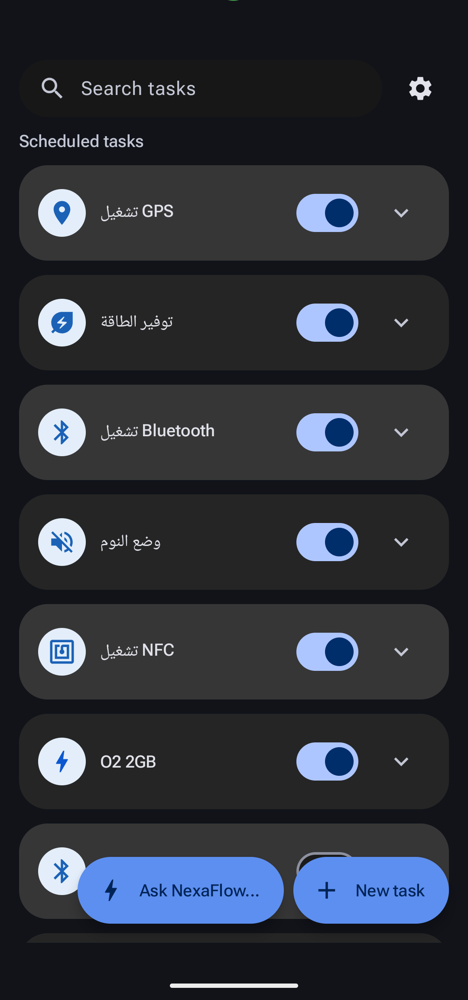
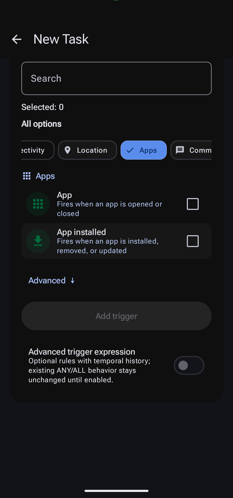
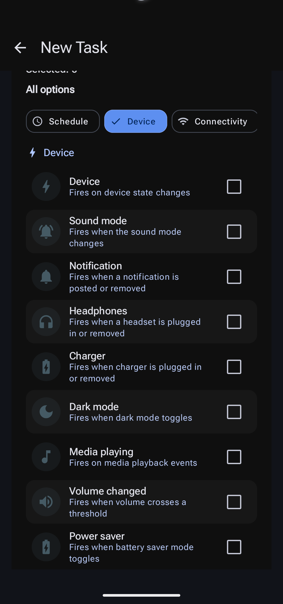
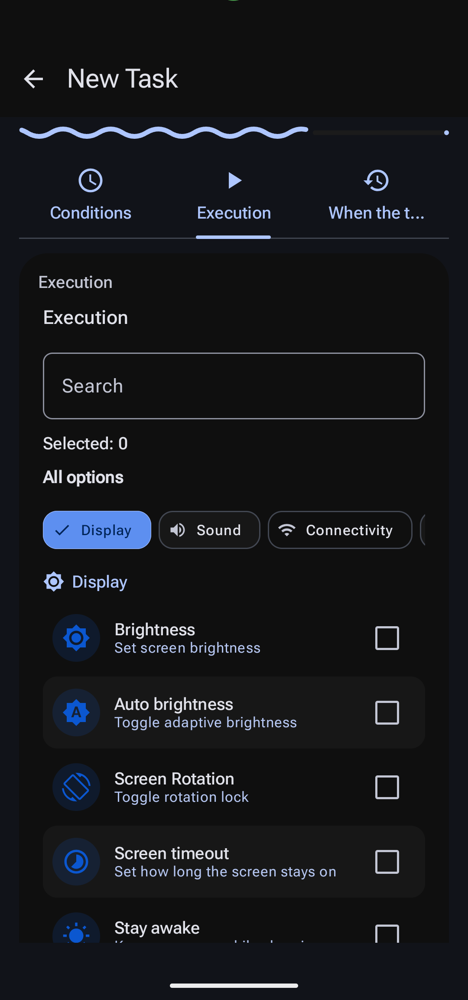
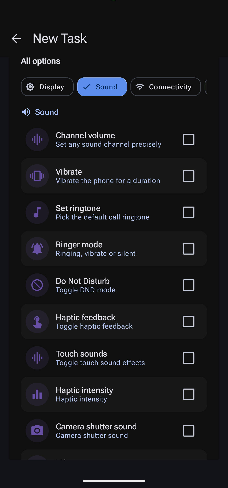
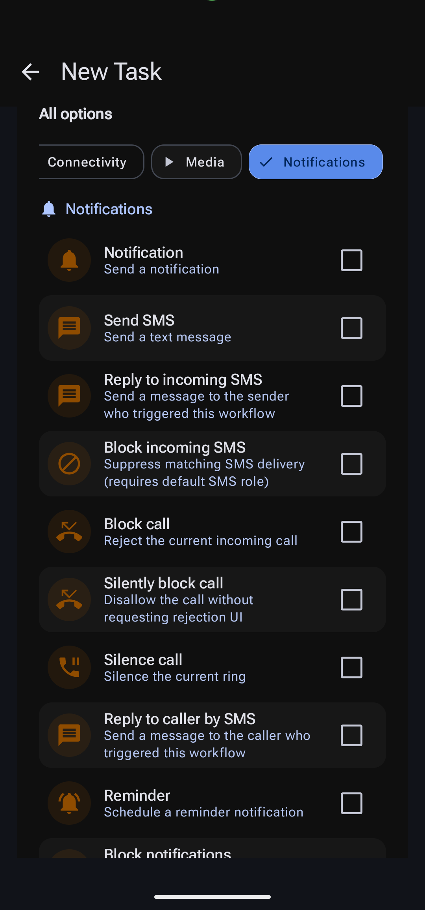
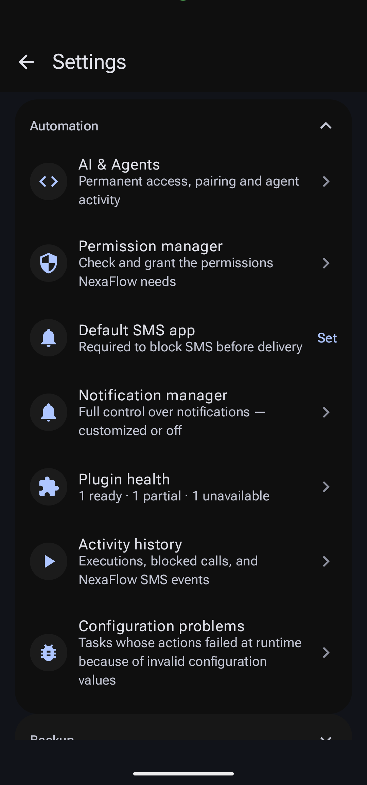
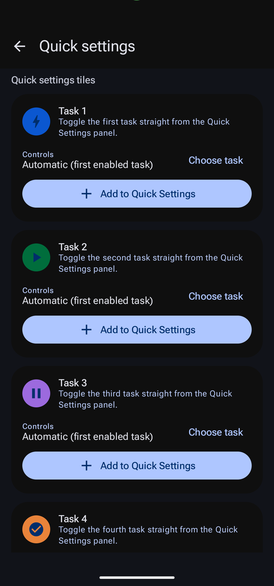

<div align="center">

# NexaFlow

**Automation for Android that explains what it did — and proves it.**

Tasks combine triggers, conditions, ordered actions and optional exit behaviour.
Every device change is verified by reading the state back, so a task reports
what actually happened instead of what was requested.

[](https://github.com/Alaa91H/NexaFlow/releases)
[](LICENSE)
[](https://developer.android.com)
[](https://t.me/NexaFlowApp)

[**Download**](https://github.com/Alaa91H/NexaFlow/releases) ·
[**Channel**](https://t.me/NexaFlowApp) ·
[**Community**](https://t.me/NexaFlowCommunity) ·
[**Documentation**](docs/README.md)

</div>

---

## Screenshots

<table>
  <tr>
    <td align="center"><br><sub><b>Tasks</b> — enable, search and inspect</sub></td>
    <td align="center"><br><sub><b>Triggers</b> — grouped and searchable</sub></td>
    <td align="center"><br><sub><b>Device events</b> — charger, headset, DND</sub></td>
    <td align="center"><br><sub><b>Actions</b> — display controls</sub></td>
  </tr>
  <tr>
    <td align="center"><br><sub><b>Sound</b> — volume, ringer, DND</sub></td>
    <td align="center"><br><sub><b>Calls &amp; SMS</b> — reply, block, silence</sub></td>
    <td align="center"><br><sub><b>Settings</b> — agents, permissions, history</sub></td>
    <td align="center"><br><sub><b>Quick Settings</b> — four task tiles</sub></td>
  </tr>
</table>

## Features

### Triggers and conditions
- **Time and schedules** — one-off and recurring windows, day-of-week selection and explicit start/end times.
- **App and screen events** — app opened or closed, screen on/off, unlock, rotation.
- **Device state** — charger, headset, battery level, power saver, dark mode, media playback, volume, sound mode.
- **Connectivity** — Wi-Fi, Bluetooth, mobile data, hotspot, NFC, VPN, USB and HDMI.
- **Communication** — incoming SMS and calls, notification posted or removed.
- **Location and sensors** — geofences, activity recognition, light, proximity, pressure, humidity, temperature and hinge sensors where the hardware exists.
- **Plugins and advanced expressions** — Tasker/MacroDroid-compatible plugin events and optional ANY/ALL rules with temporal history.

### Actions
- **Display and sound** — brightness (including adaptive), rotation, screen timeout, stay-awake, dark mode, stream volumes, ringer mode, Do Not Disturb, vibration and haptics.
- **Connectivity** — Wi-Fi, Bluetooth, mobile data, hotspot, NFC, airplane mode, network mode.
- **Calls and messages** — send SMS, reply to the sender, block or silence calls, reply to a caller, block notifications, post reminders.
- **Apps and media** — launch or kill apps, open Play Store updates, media control, navigation.
- **Data actions** — text, encoding, hashing, random values, decimal arithmetic, dates, JSON and arrays. Outputs feed later actions in the same run.
- **HTTP and webhooks** — HTTPS requests with method, body, headers, timeout, retries and output path; local authenticated webhooks and revocable task links.
- **ROM settings** — write any system setting, Quick Settings tiles, status bar, lock screen, theme and Always-On display controls.

### Execution you can audit
- **Capability-Adaptive Execution** — device-state actions are expressed as precise operations (`WIFI_SET_STATE`, `DND_GET_STATE`, …). One `CapabilityRouter` chooses the least-privileged strategy available: public Android API → settings permission → Shizuku → root → documented Settings hand-off.
- **Verified results** — every change is read back and compared with the requested state. An uncertain transport outcome is reconciled by observation instead of guessed, and the router never falls back blindly after a possible side effect.
- **History and diagnostics** — per-run activity history, configuration problem reports, blocked-call and SMS event records, and exportable diagnostics.
- **Reliability controls** — cooldowns, constraints, workflow context, visit limits and explicit failure reporting instead of silent success.

### Agents, plugins and the ecosystem
- **In-app AI agents** — define reusable agents, choose a provider, and run a saved agent from a task with approval policies and a full audit ledger.
- **Plugin SDK** — extend triggers, conditions and actions with compatible third-party plugins, with health and compatibility reporting.
- **Wear OS companion** — the watch app mirrors task state and can trigger defined tasks.
- **Backup and sharing** — full backup and single-task sharing. Imported tasks stay disabled for review and external execution tokens are stripped.
- **Widgets, Quick Settings and themes** — home-screen widgets, four configurable QS tiles, Material You dynamic colour and a per-app language selector.

## Install

1. Download `NexaFlow-<version>.apk` from the [latest release](https://github.com/Alaa91H/NexaFlow/releases).
2. For a watch, also download `NexaFlow-Wear-<version>.apk` and sideload it to the Wear OS device.
3. Install over an existing copy with the same signing identity; a different signer requires an uninstall.
4. Grant permissions from the feature that needs them — NexaFlow never asks for everything at startup.

Release pages contain only the two signed APKs. Provenance attestations are produced by the release workflow, and build logs are attached to the workflow run.

## Requirements and permissions

- Android 8.0 (API 26) or newer; compiled and targeted at API 37.
- Root and Shizuku are **optional** capability providers. Backend-specific actions require their exact provider, and Shizuku execution needs its UserService connection.
- Some actions require a system role (default SMS app, call screening, accessibility) or a runtime permission; the UI states which one before you enable the action.
- Exact alarms, background restrictions and OEM power management can delay or drop triggers. A foreground service improves reliability but does not guarantee uninterrupted execution.
- Sensor triggers need the matching hardware; pressure, humidity, ambient temperature and hinge sensors are uncommon on phones.

## Build from source

```bash
./gradlew testDebugUnitTest assembleDebug
./gradlew detekt lintDebug
python3 scripts/auto_fix.py --check
python3 scripts/check_strings_parity.py
python3 scripts/audit_catalog_and_releases.py catalog
```

Install Android SDK platform 37 and point `ANDROID_HOME` (or `local.properties`) at it.
The Gradle wrapper drives a Java 21 toolchain for the Robolectric suites, and
dependency checksums are enforced. Release signing reads the `NEXAFLOW_KEYSTORE_*`
and `NEXAFLOW_KEY_*` environment variables or ignored local keystore properties —
never commit a private key.

## Languages

The interface ships in **English, Arabic, German, Spanish, French, Hindi, Japanese,
Portuguese, Russian, Turkish and Simplified Chinese**, switchable inside the app.
Translation completeness, placeholder parity and leftover-English copy are checked
by `scripts/audit_translation_completeness.py` on every change.

## Quality and scope

- The repository runs unit and Robolectric suites, static analysis, lint, resource and
  translation gates, an atomic inventory audit and architecture fitness checks on
  every pull request.
- The [capability catalog](docs/CAPABILITY_CATALOG.md) is generated: it lists what is
  implemented, not a promise that every function works on every phone.
- A catalog entry is not a device certification. Vendor ROMs differ, and the
  [validation record](docs/VALIDATION.md) states exactly what was executed and what
  was not.
- NexaFlow has **not demonstrated overall superiority over Automate**. Counts of blocks
  and counts of triggers/actions are different units; parity in expressions, flow
  control, integrations and reliability is not claimed. See the
  [comparison and roadmap](docs/ROADMAP_2026.md).

## Privacy and security

- Automations, credentials and history stay on the device; the app has no analytics
  or advertising SDK.
- Agent providers and HTTPS requests are only contacted for the actions you configure.
  Private-network destinations require explicit opt-in, and webhooks authenticate
  every call.
- Security-sensitive reports should go to the developer by email rather than a public
  issue. Redact tokens and payloads from logs.

## Community and support

<table>
  <tr><th align="left">Where</th><th align="left">Link</th><th align="left">Use it for</th></tr>
  <tr>
    <td><b>Telegram channel</b></td>
    <td><a href="https://t.me/NexaFlowApp">@NexaFlowApp</a></td>
    <td>Release announcements, build notes and status updates</td>
  </tr>
  <tr>
    <td><b>Community group</b></td>
    <td><a href="https://t.me/NexaFlowCommunity/4">NexaFlow Community → releases topic</a></td>
    <td>Questions, task sharing and discussion with other users</td>
  </tr>
  <tr>
    <td><b>GitHub</b></td>
    <td><a href="https://github.com/Alaa91H/NexaFlow">Alaa91H/NexaFlow</a></td>
    <td>Source, issues, pull requests and the full history</td>
  </tr>
  <tr>
    <td><b>Developer</b></td>
    <td><a href="https://t.me/Alaa91h">@Alaa91h</a> · <a href="mailto:alahus2591@gmail.com">alahus2591@gmail.com</a></td>
    <td>Direct questions, security reports and collaboration</td>
  </tr>
  <tr>
    <td><b>Support</b></td>
    <td><a href="https://ko-fi.com/alaa91h">ko-fi.com/alaa91h</a></td>
    <td>Optional financial support; no feature is gated behind it</td>
  </tr>
</table>

Every published GitHub release is announced automatically in the channel and in the
community releases topic by [@NexaFlowBuildBot](https://t.me/NexaFlowBuildBot), with the
release changelog and both APKs.

When reporting a problem, include the Android version, device build, the permission
state and a minimal task that reproduces it.

## Contributing

Read [CONTRIBUTING.md](CONTRIBUTING.md), the [architecture notes](docs/ARCHITECTURE.md)
and the [required checks](docs/REQUIRED_CHECKS.md). Pull requests are expected to pass
the same gates as `main`; the release procedure is documented in
[docs/RELEASING.md](docs/RELEASING.md).

## License

NexaFlow is released under the [MIT License](LICENSE).

## Documentation

Start at the [documentation index](docs/README.md): [capability catalog](docs/CAPABILITY_CATALOG.md),
[configuration reference](docs/CONFIGURATION.md), [security model](docs/SECURITY.md),
[agent platform](docs/AGENT_PLATFORM.md), [plugin SDK](docs/PLUGIN_SDK.md) and the
[validation record](docs/VALIDATION.md). Historical audits and plans are kept for
provenance and are labelled as such.
